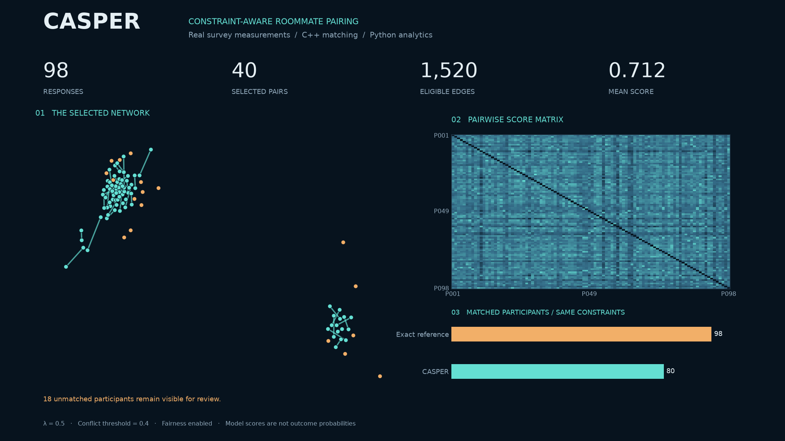
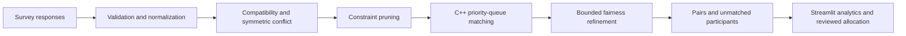

# CASPER

### Constraint-aware adaptive score-based pairing with equilibrium regulation

A roommate allocation system built around real survey responses, a C++17 matching engine, and interactive Python analytics. Explore the eligible graph, inspect the reasons behind each pairing, compare measured outcomes, and update an allocation as new responses arrive.

**98 real responses · 11 numeric features · 6 interest indicators · C++17 + Python**



*Reproducible analytical figure from the actual allocation, generated with `python scripts/render_figure.py`.*

## Run the application

Use Python 3.12 and a C++17 compiler (`g++` or `clang++`). From the repository root:

```sh
python -m venv .venv
# Windows: .venv\Scripts\activate
# macOS / Linux: source .venv/bin/activate
python -m pip install -r requirements.txt
python -m streamlit run NITW_Roommate_Optimizer/app.py
```

The native engine compiles automatically on the first run. On Windows, set `CXX` to the full path of your installed `g++.exe` if it is not on PATH. The included public dataset is derived from the original survey; no additional download or credential is needed for the matching interface.

**Deploy:** follow [Streamlit Community Cloud setup](DEPLOYMENT.md). GitHub stores the source; Streamlit runs the Python application and native engine.

## Inside the application

| Workspace | What it provides |
| --- | --- |
| Overview | Real allocation metrics, selected graph edges, exclusions, pairings and unmatched participants |
| Pair explorer | Preference radar, compatibility, conflict components and nonlinear penalty |
| Graph laboratory | Interactive network, full pairwise matrices, distributions and a downloadable figure |
| Benchmarks | Heap greedy, CASPER and exact Blossom reference on the same eligible graph |
| Survey evidence | Original-scale distributions, interests, satisfaction and provenance |
| Online matching | Add an actual response; preserve existing pairs or recompute the allocation |
| Delivery | Allocation export, actual room inventory and administrator-controlled email delivery |

## The matching pipeline



Compatibility retains the original weighted numeric similarity and Jaccard interests. Conflict averages the two directional comparisons so reversing the participants cannot change the score. CASPER selects edges by `CS − λ × CF²`, then checks both alternative swaps between two pairs without restoring excluded edges.

Fairness mode only accepts swaps that preserve total score, protect the smaller affected pair score and do not increase score variance. These guarantees apply to the unlocked refinement pool, up to floating-point tolerance. Pair count stays fixed during refinement. See [algorithm details](ALGORITHM.md).

## Measured on the supplied data

At λ = 0.5, conflict threshold = 0.4, and fairness enabled:

| Measure | Result |
| --- | ---: |
| Survey responses | 98 |
| Eligible edges | 1,520 |
| Selected pairs | 40 |
| Participants awaiting review | 18 |
| Paired coverage | 81.63% |
| Mean adjusted score | 0.711756 |
| Weakest pair score | 0.385455 |

These are computed outcomes, not estimates of successful roommate relationships. CASPER is a bounded heuristic: it does not guarantee maximum cardinality, globally optimal score or stable-roommate matching. The app calculates an exact NetworkX reference for a meaningful comparison.

## Data and access

The public measurements retain all 98 source rows with participant labels `P001`–`P098`. Names, emails, branch, submission identifiers and timestamps are removed. This is pseudonymization, not irreversible anonymization. Duplicate respondent identifiers are recorded in the provenance audit and retained for review.

The identifiable source and intermediate cleaned file are ignored by Git. To regenerate the public measurements from your locally retained source:

```sh
python scripts/prepare_data.py /path/to/private/raw_data.csv
```

Private uploads and email controls require an administrator password configured in server secrets. Public sessions cannot send email. Online changes live in the current session; download results before closing it. No database or invented participant records are included.

## Stack and verification

Python, Streamlit, pandas, NumPy, NetworkX, Plotly, Matplotlib, Seaborn, FastAPI and the C++17 engine. The application uses native Streamlit widgets and Python-generated charts. There is no separately authored frontend or frontend build step.

```sh
python -m pip install -r requirements-test.txt
python -m unittest discover -s tests -v
python scripts/benchmark.py
```

Tests cover real-data validation, symmetric scores, pruning, deterministic selection, both swap alternatives, fairness, online locks, unmatched participants, exports and API authorization. GitHub Actions repeats the checks on Linux. [Implementation scope](IMPLEMENTATION.md) documents the report requirements, adaptations and limits.
