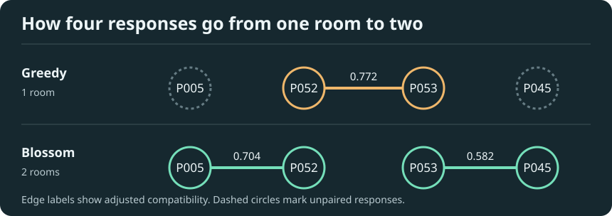

# CASPER · Roommate matching for a hostel

P052 and P053 look like an easy decision. Their compatibility score is **0.772**, and both satisfy the hostel’s pairing rules. A greedy allocator gives them a room. The catch shows up elsewhere in the list: P005 and P045 are both left waiting.

There’s a way to house all four. Pair P005 with P052 (0.704), and P053 with P045 (0.582). Both new pairs score below the original one. Both clear the same conflict threshold. One room becomes two.



That example comes from 98 real survey responses. Across the full survey, the greedy allocator fills **40 rooms** and the exact Blossom solver fills **49**. CASPER lets you follow all nine changes that account for the gap, inspect the preferences behind an edge, and decide which tradeoff you would accept as the person assigning rooms.

**Try it in the browser.** Open **Graph laboratory → Matching replay**. Start with **Score-first greedy** and move the swap slider to see which roommates change. The coverage path selector shows where rearranging a chain of pairs opens another room. [Open CASPER](https://casper-roommate.streamlit.app/)

## What the benchmark found

All methods see the same 1,520 eligible pairs out of 4,753 possibilities. The conflict threshold is 0.4 and the penalty weight is 0.5. The three allocations below answer two different operational questions: how to improve rooms already filled, and how to place as many people as possible.

| Allocation on the bundled survey | Rooms filled | People waiting | Total score | Mean per room | Weakest room | Score variance |
| --- | ---: | ---: | ---: | ---: | ---: | ---: |
| Highest score first | 40 | 18 | 28.413 | 0.710 | 0.385 | 0.01769 |
| CASPER C++ refinement | 40 | 18 | 28.470 | 0.712 | 0.385 | 0.01630 |
| Maximum-cardinality Blossom | 49 | 0 | 31.642 | 0.646 | 0.284 | 0.02253 |

**At fixed coverage**, the C++ engine accepted two swaps. Total score rose by 0.20%, the weakest room held its score, and variance across room scores fell by **7.87%**. The modest change in the total is easier to interpret alongside the narrower spread.

**When everyone needs a room**, Blossom pairs all 98 responses. It maximizes the number of rooms first, then chooses the highest total score among allocations of that size. Its total is **11.37% above greedy** and **48.89% above the mean of 200 seeded random feasible allocations**. Those percentages include the value of filling additional rooms. The lower mean and weakest-room scores show the price of full coverage on this survey. [Recorded solver results](docs/benchmark.json) · [Desktop benchmark run and figures](https://github.com/ashrith-r/casper-roommate/actions/runs/45977172515)

## How a survey response becomes an edge

Two people can share interests and still find it difficult to share a room. CASPER keeps those signals separate. Compatibility combines similarity across eleven normalized questionnaire responses (60%) with overlap across six interests (40%). Conflict accounts for sleep routines, irritability, noise and visitors, and snoring and sensitivity. For snoring, the model compares each person’s reported frequency with the other person’s sensitivity in both directions. Reversing the order of the two responses gives the same result.

The graph builder admits an edge only if the two respondents belong to the same hostel cohort and their conflict score passes the threshold. It then assigns the edge a weight:

```text
adjusted score = compatibility − λ × conflict²
```

The two controls have different jobs. Tightening the **threshold** can remove someone’s last eligible partner. Increasing **λ** changes the ranking of eligible partners while leaving those choices available. In **Pair explorer**, you can inspect compatibility, conflict and the resulting penalty for a selected room. [Feature calculations](NITW_Roommate_Optimizer/src/data/feature_engine.py) · [Graph construction](NITW_Roommate_Optimizer/src/graph/graph_builder.py)

## What the allocator can explain

**A local decision.** The C++17 engine takes eligible edges from a maximum-priority queue, skipping anyone already paired. It then considers two occupied rooms at a time and checks both ways to exchange partners. In fairness mode, an accepted exchange must preserve or improve three quantities: the total score, the lower score of the two affected rooms, and the spread of scores across the unlocked rooms (lower variance is better). At least one must improve beyond numerical tolerance. The default limit is 12 sweeps. This gives “fairness” a specific meaning that a reviewer can check against the code. [C++ matching engine](NITW_Roommate_Optimizer/cpp/casper.cpp)

**A global decision.** A swap between two occupied rooms always leaves two occupied rooms. To explain how Blossom places more people, CASPER compares the greedy and exact assignments. Edges belonging to just one assignment form alternating chains or cycles. A chain that starts and ends at people left waiting by the greedy allocator contains one more Blossom edge than greedy edge. Switching those edges fills one more room. The four-person example above is the shortest such chain on this run. [Coverage path extraction](NITW_Roommate_Optimizer/experiments/benchmark.py)

**An allocation already in use.** When another response arrives, the dashboard can preserve existing assignments or recompute the cohort. Preserved rooms are checked against the current constraints. The engine refines the remaining pool and reports anyone still waiting, so an administrator can review the exception before exporting the allocation. [Allocation pipeline](NITW_Roommate_Optimizer/src/pipeline.py)

## Reproduce the experiment

From the repository root, with Python 3.10+ in an active virtual environment:

```sh
python -m pip install -r requirements-desktop.txt
python main.py --seed 42 --trials 200
```

The command writes a JSON report and five PNG figures to `results/`. The desktop benchmark runs random feasible matching, score-first greedy, exact Blossom, and two refinements starting from Blossom. One refinement checks a single swap pattern and the other checks both. Their expected gain over Blossom is zero: any positive swap would produce a matching of the same size with more weight than the exact solution. Starting the replay from greedy shows where those swaps do help.

Run `python main.py --visualize` to open the Pygame replay. **Compare** displays all five totals, **Why coverage?** follows an alternating path, and **Switch start → Greedy start → Run** plays the accepted swaps. Use `--data` for another validated survey CSV, `--threshold` to change eligibility, and `--penalty` to change edge weights.

The shared scoring step costs O(n²d) for n responses and d features. For E eligible edges, p selected pairs and s sweeps, the native heap and refinement cost O(E log E + s·p²), in addition to initializing the native n-by-n weight matrix. Blossom adds an O(n³) exact comparison. The benchmark times matching separately from graph construction. [Algorithm details and complexity](ALGORITHM.md)

<details>
<summary>Run the Streamlit dashboard and test suite locally</summary>

Use Python 3.12 and a C++17 compiler. The dashboard builds the native engine on first use.

```sh
python -m pip install -r requirements.txt
python -m streamlit run NITW_Roommate_Optimizer/app.py
```

To check the native engine, dashboard, replay and report generation:

```sh
python -m pip install -r requirements-test.txt
python -m unittest discover -s tests -v
```

GitHub Actions runs the suite and archives the desktop report and figures. [Deployment guide](DEPLOYMENT.md)

</details>

## What the data supports

The public input contains 98 pseudonymous response rows. Names and contact details were removed. Repeated respondent identifiers were flagged in the source audit and their rows retained, so coverage counts refer to survey rows. The questionnaire records satisfaction with existing roommates, but it does not link those people into observed pairs or follow up on the proposed allocations. The benchmark therefore measures coverage and modeled compatibility. Measuring whether people lived well together would require a follow-up study. [Survey provenance](NITW_Roommate_Optimizer/data/provenance.json) · [Public measurements](NITW_Roommate_Optimizer/data/processed/participants.csv)
