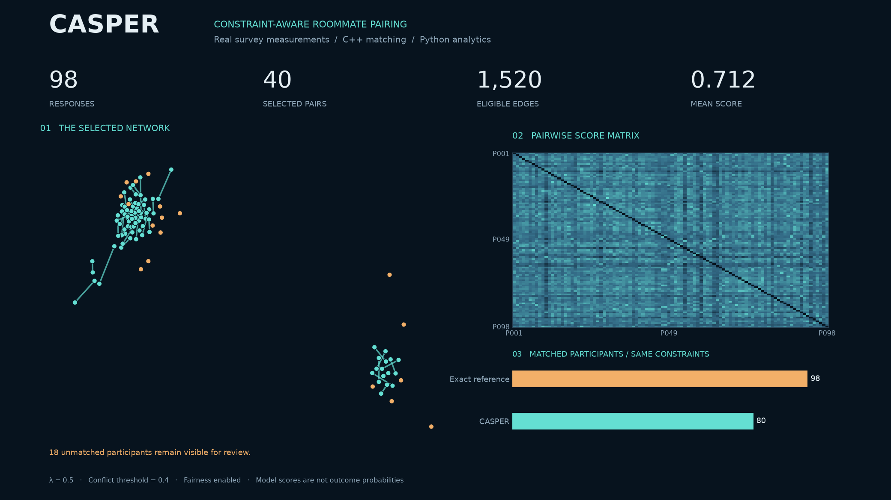

# CASPER · Who gets a roommate?

On the same 98 hostel survey responses, a greedy allocator fills **40 rooms**. An exact graph matcher fills **49**. Both obey the same conflict threshold. Where did the other nine rooms go?

CASPER lets you inspect that decision. Each survey response becomes a vertex. An edge connects two eligible roommates, and its weight reflects their routines, shared interests and potential conflicts. Run five matching methods on the graph, then step through the assignments on your desktop.



## Reproduce the result

From the repository root, with Python 3.10+ in an active virtual environment:

```sh
python -m pip install -r requirements-desktop.txt
python main.py --visualize
```

**For a one-minute demo**, click **Compare** to see all five totals. Click **Step** to move from a seeded random draw to Blossom. Switch to **Greedy start** and press **Run** to watch two rooms exchange partners whenever the move improves their combined score. The convergence plot adds a point for each accepted swap. **New data** draws up to 32 rows from the loaded survey and recomputes the comparison.

For a headless run, use `python main.py --seed 42 --trials 200`. It writes a JSON report and five PNG figures to `results/`, covering total score, negative-score pairs, convergence, runtime and relative performance. Use `--data` for another validated survey CSV, `--threshold` for the conflict limit and `--penalty` for the conflict weight.

## One graph, two allocation goals

The public dataset contains **98 response rows, 11 numeric preferences and 6 interest indicators**. At the default threshold of 0.4 and penalty weight of 0.5, **1,520 of 4,753** possible edges are eligible.

| Method | Rooms filled | Responses unpaired | Total adjusted score | Mean per room | Weakest pair |
| --- | ---: | ---: | ---: | ---: | ---: |
| Greedy, highest score first | 40 | 18 | 28.413 | 0.710 | 0.385 |
| C++ greedy + fairness refinement | 40 | 18 | 28.470 | **0.712** | **0.385** |
| Maximum-cardinality Blossom | **49** | **0** | **31.642** | 0.646 | 0.284 |

Taking the highest-scoring edge can use the only feasible partner for another student. A two-room swap can improve the rooms already filled, but it keeps their count fixed. Blossom can reorganize the matching across a longer chain. Here, it places 18 additional responses while lowering the weakest selected score. [Recorded benchmark](docs/benchmark.json) · [Scoring and C++ refinement rules](ALGORITHM.md)

## What the experiment measures

The score is `compatibility − λ × conflict²`. Compatibility blends similarity across 11 normalized responses with Jaccard overlap across interests. Conflict includes sleep, irritability, noise versus visitors, and snoring versus sensitivity. Cohort membership and the conflict threshold determine which edges a solver may select.

| Desktop method | Decision rule | Matching time after scoring |
| --- | --- | --- |
| Random feasible | Shuffle eligible edges, accept disjoint pairs, average 200 trials by default | O(E) per trial |
| Score greedy | Visit eligible edges in descending weight order | O(E log E) |
| Blossom | Maximize pair count, then total weight at that count | O(N³) |
| Blossom + one swap pattern | Test one way to reconnect two selected pairs | O(N³ + I P²) |
| Blossom + both patterns | Check eligible fallback and both ways to reconnect two rooms, recording each accepted move | O(N³ + I P²) |

`N` counts responses, `E` eligible edges, `P` selected pairs and `I` search passes. Feature scoring takes O(N²d) for `d` features. Timings exclude the shared graph build. Random results are trial means, while the replay starts with one draw. All methods leave unpairable participants visible. A negative adjusted score and an excluded edge are counted separately.

**Why can the exact-start replay end with zero swaps?** A positive-gain swap would be another matching of equal size and greater weight, contradicting Blossom's objective. The one-pattern and two-pattern runs test that prediction. The greedy-start replay uses the same two-pattern search to show genuine improvements. The C++ engine in the table uses a different acceptance rule that also protects the weaker affected pair and the variance of scores.

## Inspect or extend it

- [Desktop benchmark](NITW_Roommate_Optimizer/experiments/benchmark.py) and [replay](NITW_Roommate_Optimizer/src/visualization/graph_viz.py)
- [Compatibility and conflict model](NITW_Roommate_Optimizer/src/data/feature_engine.py) and [C++17 engine](NITW_Roommate_Optimizer/cpp/casper.cpp)
- [Survey provenance](NITW_Roommate_Optimizer/data/provenance.json) and [public input](NITW_Roommate_Optimizer/data/processed/participants.csv)

The original allocation dashboard supports pair explanations, reviewing unmatched participants, locking assignments when new responses arrive and exporting results. To run it, use Python 3.12 and a C++17 compiler:

```sh
python -m pip install -r requirements.txt
python -m streamlit run NITW_Roommate_Optimizer/app.py
```

To verify both interfaces and the native engine:

```sh
python -m pip install -r requirements-test.txt
python -m unittest discover -s tests -v
```

Names and contact details were removed from the public survey. Repeated responses were retained and flagged in the source audit. The scores measure the stated preference model. The survey contains no follow-up outcomes for the proposed roommates. [Data and deployment notes](DEPLOYMENT.md) · [Implementation scope](IMPLEMENTATION.md)
